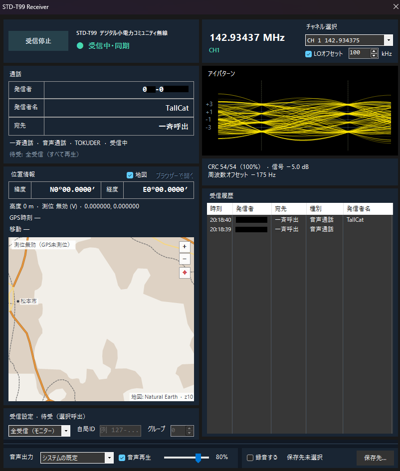

# STD-T99 Receiver for SDR#

SDR#でARIB STD-T99 Annex 2（デジタル小電力コミュニティ無線、通称デジコミ）を受信するプラグインです。
選局した1チャネルを復調し、発信者・宛先・発信者名・位置情報・GPS時刻・緊急通信などの受信情報を表示し、TOKUDER音声をニューラルデコーダーで再生します。
このプラグインは [std-t99-receiver](https://github.com/tallcat4/std-t99-receiver)、[tokuder-neurodec](https://github.com/tallcat4/tokuder-neurodec)、[SPEAR](https://github.com/tallcat4/SPEAR) をベースに、[std-t98-receiver-sharp](https://github.com/tallcat4/std-t98-receiver-sharp) と同じ構成でSDR#向けにプラグイン化したものです。

<p align="center">
  
</p>

## インストール方法

1. `STD-T99-Receiver.zip` を展開し、`Plugins/SDRSharp.T99` フォルダーをSDR#の `Plugins` 内へコピーします。
2. SDR#を起動し、`STD-T99 Receiver` パネルを開きます。

## 使い方

パネル上部の「チャネル選択」でCH1〜18を選ぶと、SDR#の周波数がそのチャネルに合います（CH18 146.984375 MHz は呼出チャネル）。SDR#側で直接選局しても構いません。T99のチャネルに一致すれば選択欄も追従します。
「受信開始」を押すと、復調・受信情報の表示・音声再生が自動で始まります。

### LOオフセット

チャネル選択で選局するとき、SDR#の中心周波数（LO）をチャネルから「LOオフセット」の量（初期値 100 kHz）だけ下げて設定します。

- オフセットはIQレートの40%を上限に自動で抑えます。
- SDR#で中心周波数を固定している場合や、チューナーではないソース（WAV再生など）では、LOは動かさず周波数だけ合わせます。
- SDR#側で直接選局してチャネルがLOの±10 kHz以内にあるときは、パネルに「LO付近」と警告を出します。

## 画面

- 左列: 通話（発信者・発信者名・宛先・通話種別・着信判定）、位置情報と地図、受信設定（待受）
- 右列: アイパターン、受信品質（CRCの通過率、信号レベル、周波数オフセット。IQや音声の欠落があればその数）、受信履歴
- 最下部（区切り線の下）: このPCの設定。音声出力（出力先・再生・音量）と録音（保存先）


## 受信機能（ARIB STD-T99 Annex 2）

| 機能 | 表示・動作 |
|---|---|
| 音声通信（2.3.2） | 個別・グループ・一斉通話を区別して表示し、TOKUDER音声を再生します |
| 発信者番号（2.4.3） | 発信者の機器ID（`メーカー識別3桁-個別ID 7桁`）、識別符号の拡張部 |
| 宛先 | 個別通話は宛先の機器ID、グループ通話はグループ番号、一斉通話は「一斉呼出」 |
| 発信者名表示（2.3.3.3） | Shift_JISの発信者名 |
| 緊急通信（2.3.3.2） | 緊急通信1・2を赤い帯で、緊急応答を橙の帯で表示し、受信履歴にも残します |
| 位置通信（2.3.4） | 緯度・経度（度分、10進）、高度、測位の有効/無効、GPS時刻（JST）、送信局の移動速度・進行方向・内蔵の日本地図に発信位置をピンで表示 |
| 遠隔制御・各種要求（2.3.4.2、2.3.5） | 位置要求・遠隔送信要求・機器ID要求を受信したことを表示します |
| 選択呼出（4.5、表 Annex 2-4-14） | 待受の設定で、自局宛てでない通話を再生しません|
| 受信履歴 | 送信ごとに時刻・発信者・宛先・種別（緊急は赤）・発信者名を最新100件まで表示します |

### 待受（選択呼出）

| 設定 | 再生する通話 |
|---|---|
| 全受信（モニター、初期値） | すべて |
| 個別待受 | 宛先が自局機器IDの個別通話 |
| グループ待受 | 自局グループ番号のグループ通話、一斉通話、自局機器ID宛ての個別通話。グループ番号0はすべてのグループ |

表示と録音は待受の設定によらず、受信したすべての通話が対象です。

## 地図

位置情報カードに、プラグインに内蔵した日本地図を表示し、受信した発信位置にピンを立てます。

- 内容: 陸地・都道府県境と都道府県名、市街地、湖・主要河川、鉄道、高速道路・主要道路、主な都市名（[Natural Earth](https://www.naturalearthdata.com) 1:10m、パブリックドメイン）。
- ピン: 最後の通話の位置を赤いピン、受信履歴にある他の発信者の最後の位置を橙の点で表示します。
- 日本国外の座標や測位無効（GPS未測位）の位置にはピンを立てません。
- 詳しい地図が必要なときは「ブラウザーで開く」でOpenStreetMapを開けます。

## 音声（TOKUDER）

TOKUDERの仕様は公開されていないため、[tokuder-neurodec](https://github.com/tallcat4/tokuder-neurodec) の実験的なニューラルデコーダー（`tokuder48_causal_v1`、約440万パラメータ）をC++へ移植し、受信しながら逐次に復号しています。
誤り訂正（2 × 拡大Golay [24,12]）は受信の軟判定値で最尤復号します。
音声以外の信号は再現しません。学習データ・品質・重みの扱いについては tokuder-neurodec のREADMEを参照してください。

## 録音

録音を有効にすると、同じファイル名で次を保存します。

- `.wav`: 8 kHz / PCM16。復号したTOKUDER音声。受信した音声区間を連結し、送信間の無信号時間は保持しません。
- `.burst`: 音声フレーム（TCH/TCH）、1レコード41 byte（std-t98系と同じ形式）。
- `.llr`: `.burst` と対応する軟判定、1レコード288 byte。
- `.jsonl`: 全フレームの受信時刻・RICH・SACCH・PICH/FACCH・復号したメッセージ・生ビット。

`.jsonl` と `.llr` をそれぞれ `rf.jsonl`・`rf.llr` という名前で1つのフォルダーに置くと、`tokuder2wav` で再処理できます。詳細は [FORMAT.md](FORMAT.md) を参照してください。

## ビルド

必要環境: Windows x64、C++20対応MinGW GCC、.NET 8対応SDK、Python 3.11以降、ローカルのSDR# x64。

```powershell
./tools/build.ps1 -SdrSharpExe C:/SDRSharp/SDRSharp.dotnet8.exe
./tools/check.ps1      # 試験信号による受信系の確認、PyTorchとの一致確認、SDR#ホストの模擬
./tools/package.ps1    # artifacts/ に STD-T99-Receiver.zip
```

FFTW開発ファイルがなければ `tools/setup-fftw.ps1` で取得し、ハッシュを検証します。
音声モデル（`models/tokuder48_causal_v1.bin`）はDLLに埋め込みます。tokuder-neurodecのチェックポイントから `tools/export-model.py` で作り直せます（PyTorchが必要）。

## 実機なしでの確認

`build/spec-iq.exe` は規格書7.7.2の試験信号（個別音声通話・発信者名付き位置通知・緊急通信・発信者名付きグループ通話）からIQを合成します。
`tools/check.ps1` はこれをSDR#相当のIQレート（37.5〜250 kHz）・周波数ずれ（±600 Hzまで）で受信し、4送信・29フレームがすべてCRC正常で、
発信者名「無線試験No.9」、N35°40.2565′ E139°45.0235′、緊急通信1などが取れることを確かめます。実機での受信感度・相互運用は未確認です。

## ライセンス・由来

[GPL-3.0](LICENSE)。再利用したコードと規格対応は [PROVENANCE.md](PROVENANCE.md)、第三者ライセンスは [THIRD_PARTY_NOTICES.md](THIRD_PARTY_NOTICES.md) を参照してください。

<sub>TOKUDER はアイコム株式会社の登録商標です。このプラグインはアイコム株式会社とは関係がなく、同社の承認・関与を受けたものではありません。「TOKUDER」の名称は、ARIB STD-T99 の音声フレームとの互換性を示す目的でのみ使用しています。</sub>
